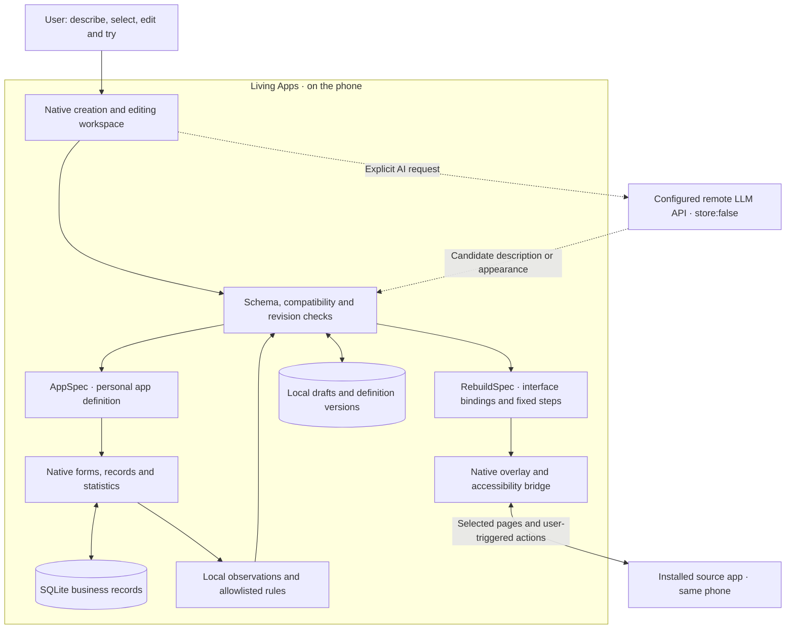

# Living Apps

**English** | [简体中文](README.zh-CN.md)

Create your own apps and let them evolve with use. Living Apps is a local-first Android platform: one host app for creating, editing and running personal apps, with usage observations and restorable versions.

[Project homepage](https://www.ipsyonline.xyz/living-apps/) · [Download](https://github.com/Jayden-Lin97/living-apps/releases) · [Watch the film](https://www.ipsyonline.xyz/living-apps/#demo) · [Issues](https://github.com/Jayden-Lin97/living-apps/issues)

## Vision: redefining the next generation of apps

**Let people shape the apps they use: what they do, how they work and how they evolve.**

We want Living Apps to become a personal app layer on Android. In one space, people should be able to turn an idea into an app, design a new interface for an app they already use, and keep adapting those experiences through everyday use. Natural language and direct interaction make that process accessible to people without programming experience.

In this vision, an app has a continuing relationship with its user: its interface can change, its useful data can persist, and improvements can be proposed, tried and restored. The agent helps that process while the user controls the direction and the permissions. Personalization includes behavior and interaction, as well as appearance.

Version 0.3.0 is an initial implementation of this direction: bounded personal-app creation, installed-app interface reconstruction and local rule-based improvement. Richer app categories and broader compatibility remain development goals.

## What makes Living different

| Design choice | Value for the user | Current implementation |
|---|---|---|
| Apps represented as editable definitions | Creation and later changes share the same understandable editing process | Natural language and native controls modify constrained AppSpec data, interpreted by the Android host |
| A personal interface over an installed app | Users can choose how to interact with an existing app while it continues to perform the business operations | RebuildSpec binds selected page information, dynamic lists and fixed actions to a native overlay; compatibility is checked per function |
| An observe–propose–try–adopt–restore lifecycle | An app can keep adapting after its first creation | Local events and rules produce suggestions; optional automatic adoption currently permits only adding quick entry to record apps |
| Interface versions separated from business records | Users can try and restore UI changes while keeping their records | Stable field IDs, persistent drafts, isolated trial records, revision checks and restorable versions; data conversion has a separate verified flow |
| A reusable on-device engine | Different personal interfaces use a common runtime and adaptation format | Native components, semantic selectors, bounded workflows and local validation; AI APIs assist creation/editing rather than handling every tap |

These mechanisms work together: create an experience, use it, adjust it and keep control of the change. Installed-app reconstruction currently relies on user-selected bindings and demonstrations; it does not automatically understand every app. Its agent-assisted editing changes appearance and existing component order/labels, without inventing device operations.

## What you can do

- Start from an offline template or describe an app to a configurable AI API.
- Select objects on the app screen, use offline controls or natural language, and keep a persistent draft with undo/redo.
- Try changes with isolated records, review differences, resolve conflicts and save a version.
- Run forms, records, lists, check-ins and basic statistics locally. Group/hide fields, configure preset record actions and use a separate verified data-conversion flow.
- Let local rules suggest improvements. Automatic adoption is off by default and currently limited to adding quick entry, with permission, freezing, cooldown and restoration.

Version 0.3.0 adds [Reconstruct an existing app](docs/REBUILD_MODE.md): select an installed app, bind current-page information, dynamic lists and explicit fixed operations, then design and locally try your own interface. This is a common engine, not universal compatibility; real QQ Music acceptance is still pending.

Version 0.3.1 is a development preview for Android 8.0+. Free-form layouts, arbitrary generated code, arbitrary network actions and general workflows are not supported. Installed-app reconstruction has a separate, bounded operation schema. The Android UI supports English and Simplified Chinese, with a system-default option in Settings; public documentation is also bilingual.

## Get started

Install the development-signed APK from [Releases](https://github.com/Jayden-Lin97/living-apps/releases). Spending, water and reading templates work offline with no fabricated records. Configure your own HTTPS API endpoint and key only when you need AI. The app includes no private gateway or developer credentials. Default model: `gpt-6.1-sol`; no silent model fallback.

Edits remain in a local draft until you review and save. Trial records stay separate. Restoring a UI version preserves business records. Data conversion has its own preview, verified backup and transaction.

## Technical architecture

Living Apps uses native Java and Android Views on Android 8.0+. Two definition formats share the host UI while retaining separate execution and storage boundaries:



| Part | Responsibilities and boundaries |
|---|---|
| Personal-app runtime | [AppSpec](app/src/main/java/dev/livingapps/core/AppSpec.java), the native UI and [Store](app/src/main/java/dev/livingapps/Store.java) handle forms, records, statistics, drafts and versions. Layout changes do not delete business records |
| Installed-app reconstruction | [RebuildSpec](app/src/main/java/dev/livingapps/core/RebuildSpec.java), [RebuildStore](app/src/main/java/dev/livingapps/RebuildStore.java) and the [accessibility service](app/src/main/java/dev/livingapps/RebuildAccessibilityService.java) handle interface bindings and fixed operations. The source app retains its account and business data; version/signature checks and ambiguous-target rejection constrain execution |
| Observation and evolution | [ReflectionEngine](app/src/main/java/dev/livingapps/core/ReflectionEngine.java), version policy and Android JobScheduler implement local aggregation and limited suggestions/automatic changes for record apps. Reconstruction does not run an autonomous cross-app planner |
| AI assistance | [ResponsesClient](app/src/main/java/dev/livingapps/ResponsesClient.java) calls the user's configured API. Responses remain candidates until local validation and the relevant adoption flow; arbitrary generated code is never executed |

### Computation and data placement

| On your phone | Configured remote API |
|---|---|
| Native UI and language settings, installed-app bindings/overlays/workflows, SQLite records, statistics, search, drafts, undo/merge, trials, preset actions, data conversion/backups, versions, compatibility, observation, rules and scheduling | Natural-language creation/editing and user-requested deeper analysis |

No dedicated business backend or on-device large model is required. API requests include `store:false` and do not automatically upload business records. Keys use Android Keystore and are excluded from APKs and backups. HTTP is permitted only for local development hosts; use a trusted HTTPS service for remote APIs.

Connected source apps retain their own network requirements. Reconstruction does not turn their pages into unrestricted background APIs. See [architecture and computation](docs/DEVELOPMENT_PLAN.md), [AppSpec](docs/SCHEMA.md) and [reconstruction boundaries](docs/REBUILD_MODE.md) for implementation details.

## Documentation

- [User guide](docs/USER_GUIDE.md)
- [Native interface](docs/UI_DESIGN.md)
- [Editing interaction design](docs/APP_EDITING_INTERACTION.md)
- [Architecture and computation](docs/DEVELOPMENT_PLAN.md)
- [AppSpec and data compatibility](docs/SCHEMA.md)
- [Reconstructing installed apps](docs/REBUILD_MODE.md)
- [Open-source licenses and references](docs/OPEN_SOURCE_REVIEW.md)
- [Validation and device-testing limits](docs/VALIDATION.md)
- [Roadmap](docs/ROADMAP.md)
- [Contributing](CONTRIBUTING.md) · [Security](SECURITY.md) · [MIT license](LICENSE)

The image below is an actual Android native View host render with synthetic data, not a physical-device screenshot:


## Build and validate

Requires JDK 17, Android SDK Platform 35 and Gradle 8.9. On Windows:

```powershell
.\scripts\build.ps1 -JavaHome 'C:\path\to\jdk17' -AndroidSdk 'C:\path\to\android-sdk'
```

The Gradle Wrapper downloads dependencies on first use. `-GradleHome` can select a local Gradle 8.9. Output uses `%LOCALAPPDATA%\LivingAppsDevelopment\build` to avoid non-ASCII Windows class-loading issues; the APK is copied to `dist/`. The script runs unit/framework tests and lint, and builds app/device-test APKs. Add `-DeviceTests` only with a connected device. Compiling device tests does not mean they ran.

On macOS/Linux, configure `sdk.dir` in `local.properties`, then run `sh ./gradlew testDebugUnitTest lintDebug assembleDebug assembleDebugAndroidTest`. That platform entry has not yet been exercised here.

```text
python scripts/check_i18n.py
python scripts/check_app_languages.py
python scripts/audit_artifact.py
python scripts/package_delivery.py
```

Source archives use an explicit product-file allowlist. Normal tests are offline and never call paid APIs. For an opt-in live probe, set `LIVING_APPS_BASE_URL` and `LIVING_APPS_API_KEY` in the process environment and run `python scripts/probe_api.py --generate`, `--edit` or `--editor`. Never place credentials in scripts or command history.

Project code is MIT licensed. Third-party code/assets retain their licenses under `licenses/`.
