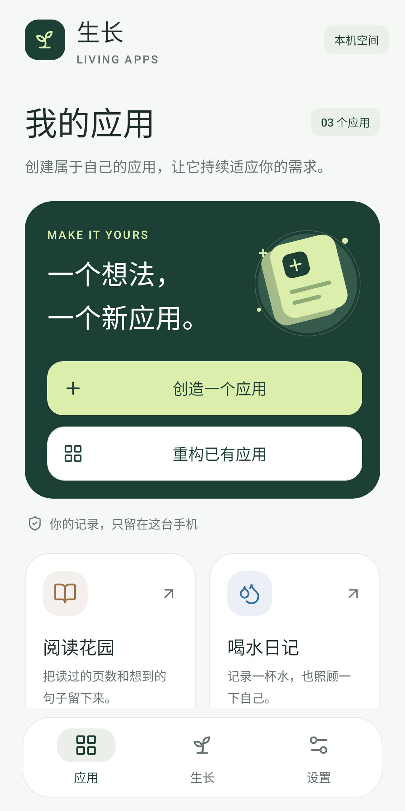

# 生长 · Living Apps

[English](README.md) | **简体中文**

让每个人创建自己的应用，并在使用中持续演进。生长是 Android 本地优先的个人应用平台：在一个母应用内创建、编辑和运行自己的应用，结合使用观察与可恢复版本持续改进。

[项目主页](https://www.ipsyonline.xyz/living-apps/index.zh-CN.html) · [下载](https://github.com/Jayden-Lin97/living-apps/releases) · [观看宣传片](https://www.ipsyonline.xyz/living-apps/index.zh-CN.html#demo) · [问题反馈](https://github.com/Jayden-Lin97/living-apps/issues)

## 可以做什么

- 从离线模板开始，或向可配置的 AI API 描述应用。
- 在应用画面中点选对象，通过离线控件或自然语言修改，保留持久草稿、撤销与重做。
- 使用隔离记录试用，检查差异、解决冲突并保存版本。
- 在本机运行表单、记录、清单、打卡和基本统计，支持分组 / 隐藏、预设记录动作及独立的数据转换流程。
- 由本地规则提出改进建议。自动采用默认关闭，当前只允许增加快速记录入口，服从授权、冻结、冷却与恢复机制。

0.3.0 新增[重构已有应用](docs/REBUILD_MODE.zh-CN.md)：选择已安装应用，选取当前页面信息、动态列表及固定操作，设计自己的界面后逐项本机试用。采用通用引擎，不承诺任意应用或全部功能兼容；真实 QQ 音乐验收仍待真机完成。

0.3.0 为 Android 8.0+ 开发预览版。尚不支持自由布局、任意生成代码、任意联网动作或通用工作流；已安装应用重构使用独立、有限的操作描述。当前 Android 界面为中文，对外文档提供中英版本。

## 开始使用

从 [Releases](https://github.com/Jayden-Lin97/living-apps/releases) 安装开发签名 APK。记账、喝水、阅读模板可离线使用，没有虚构记录。需要 AI 时才配置自己的 HTTPS API 地址与 Key；应用不预设私人网关或开发凭据。默认模型 `gpt-6.1-sol`，不静默切换模型。

修改先进入本机草稿，检查后再保存，试用记录与正式记录分开。恢复 UI 版本保留业务记录；数据转换使用独立演算、校验备份和事务。

## 本地优先架构

| 手机本地 | 用户配置的远端 API |
|---|---|
| 原生 UI、已安装应用绑定 / 覆盖界面 / 固定流程、SQLite 记录、统计、搜索、草稿、撤销 / 合并、试用、固定动作、数据转换 / 备份、版本、兼容校验、观察、规则与调度 | 自然语言创建 / 编辑、用户主动发起的深度分析 |

无需自建业务后台或手机本地大模型。请求包含 `store:false`，不自动上传业务记录；Key 经 Android Keystore 保护，不进入 APK 或备份。HTTP 仅允许本机开发地址，远端 API 使用可信的 HTTPS 服务。

## 文档

- [使用指南](docs/USER_GUIDE.zh-CN.md)
- [原生界面](docs/UI_DESIGN.zh-CN.md)
- [应用编辑交互方案](docs/APP_EDITING_INTERACTION.zh-CN.md)
- [架构与计算部署](docs/DEVELOPMENT_PLAN.zh-CN.md)
- [AppSpec 与数据兼容](docs/SCHEMA.zh-CN.md)
- [开源许可与参考](docs/OPEN_SOURCE_REVIEW.zh-CN.md)
- [验证与设备测试边界](docs/VALIDATION.zh-CN.md)
- [路线](docs/ROADMAP.zh-CN.md)
- [参与贡献](CONTRIBUTING.zh-CN.md) · [安全问题](SECURITY.zh-CN.md) · [MIT 许可](LICENSE)

下图为实际 Android 原生 View 宿主渲染，含合成数据，不是真机截图：



## 构建与验证

需要 JDK 17、Android SDK Platform 35、Gradle 8.9。Windows：

```powershell
.\scripts\build.ps1 -JavaHome 'C:\path\to\jdk17' -AndroidSdk 'C:\path\to\android-sdk'
```

Gradle Wrapper 首次下载依赖，也可用 `-GradleHome` 选择本地 Gradle 8.9。输出到 `%LOCALAPPDATA%\LivingAppsDevelopment\build`，避免 Windows 非 ASCII 路径的类加载问题，APK 复制到 `dist/`。脚本执行单元 / 框架测试与 lint，编译主 APK 和设备测试 APK。有已连接设备才加 `-DeviceTests`；测试编译不等于执行。

macOS/Linux 配置 `local.properties` 的 `sdk.dir` 后可运行 `sh ./gradlew testDebugUnitTest lintDebug assembleDebug assembleDebugAndroidTest`，该平台入口尚未在此实测。

```text
python scripts/check_i18n.py
python scripts/audit_artifact.py
python scripts/package_delivery.py
```

源码归档使用显式的产品文件允许列表。普通测试离线运行，不调用付费 API。显式真实探测需在进程环境设置 `LIVING_APPS_BASE_URL`、`LIVING_APPS_API_KEY`，再运行 `python scripts/probe_api.py --generate`、`--edit` 或 `--editor`；凭据不要写进脚本或命令历史。

自有代码使用 MIT；第三方代码与资源保留 `licenses/` 中的原许可。
