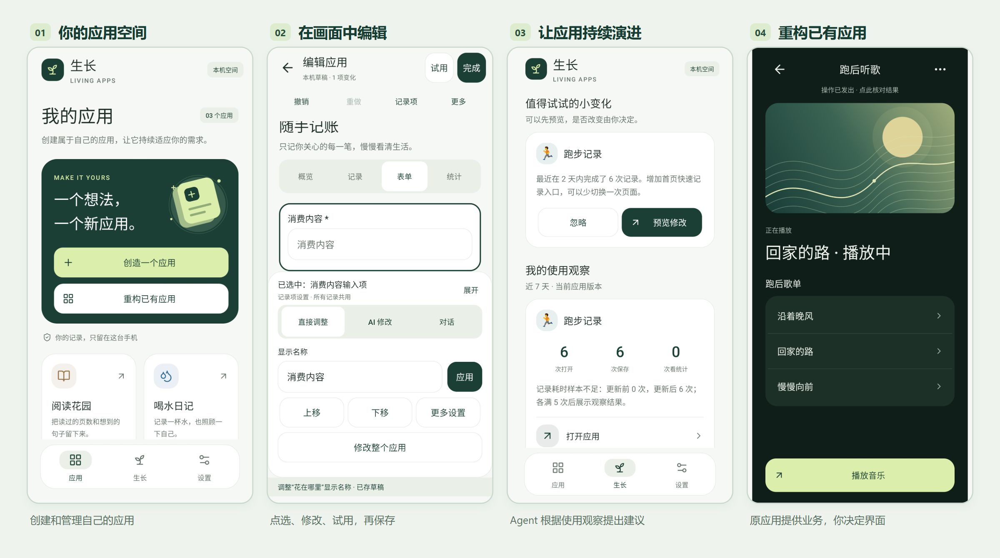
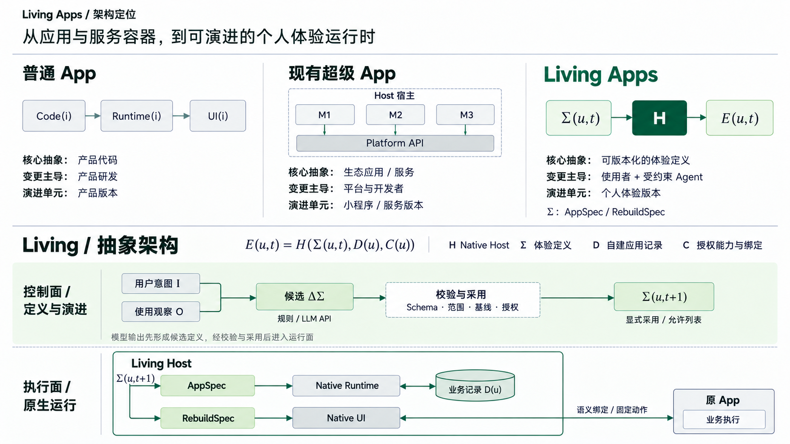
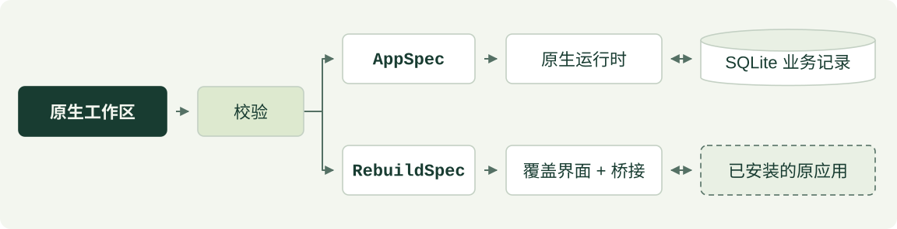

# 生长 · Living Apps

[English](README.md) | **简体中文**

让每个人创建自己的应用，并在使用中持续演进。生长是 Android 上的个人应用平台：从想法创建应用，为已安装应用设计新的操作界面，并在日常使用中持续调整体验。

[项目主页](https://www.ipsyonline.xyz/living-apps/index.zh-CN.html) · [下载](https://github.com/Jayden-Lin97/living-apps/releases) · [观看宣传片](https://www.ipsyonline.xyz/living-apps/index.zh-CN.html#demo) · [问题反馈](https://github.com/Jayden-Lin97/living-apps/issues)

**交流与合作：** [linjingkai97@163.com](mailto:linjingkai97@163.com)，欢迎产品想法、技术交流与合作洽谈。



*你的应用空间 → 在画面中编辑 → 在使用中持续演进 → 重构已有应用。画面为含合成数据的 Android 原生 View 宿主渲染，非真机截图。点击图片可放大查看。*

## 愿景：重新定义下一代超级 App

**让使用者能够决定应用的功能、交互方式与演进方向。**

我们希望 Living Apps 成为 Android 上的个人应用层：在同一个空间里，把一个想法变成应用，为已经使用的应用设计新的操作界面，并让这些体验随着日常使用持续调整。通过自然语言和直接交互，让没有编程经验的人也能参与应用的创建与改变。

在这个愿景里，应用与使用者保持持续的关系：界面可以改变，有用的数据能够保留，改进可以被提出、试用和恢复。Agent 帮助完成这个过程，使用者掌握方向和授权。个性化涵盖行为与交互，也涵盖外观。

0.3.0 是这一方向的初步实现，包含有限范围的个人应用创建、已有应用界面重构，以及规则驱动的改进。更丰富的应用类型和更广的兼容范围仍是后续目标。

## Living 的不同之处



*对比核心抽象、变更控制权与演进单元，并展开 Living 的定义控制面与原生执行面。点击图片可放大。*

| 设计重点 | 对使用者的价值 | 当前实现 |
|---|---|---|
| 把应用表达为可编辑的描述 | 创建与后续修改采用同一套可理解的编辑过程 | 自然语言与原生控件修改受约束的 AppSpec 数据，由 Android 母应用解释运行 |
| 在已有应用之上提供个人界面 | 使用者可以选择操作方式，原应用继续完成实际业务 | RebuildSpec 将选取的页面信息、动态列表和固定动作绑定到原生覆盖界面，逐功能检查兼容 |
| 观察—建议—试用—采用—恢复的持续生命周期 | 应用在首次创建后仍能根据使用情况调整 | 使用事件与规则提出建议；可选自动采用目前仅允许为记录类应用增加快速记录入口 |
| 将界面版本与业务记录分开 | 尝试和恢复界面变化时，能够保留已有记录 | 稳定字段 ID、持久草稿、隔离试用记录、版本基线检查和版本恢复；数据转换另有独立校验流程 |
| 创建与重构共用的运行引擎 | 不同个人界面共用运行机制与适配格式 | 原生组件、语义控件定位、有限固定流程及兼容检查；AI API 辅助创建与编辑，无需处理每一次点击 |

这些机制串起完整过程：创建体验、实际使用、持续调整，并掌握改变的边界。已有应用重构当前依靠用户选取和示范建立适配，不能自动理解所有应用。该模式的 AI 编辑仅调整外观及已有组件的顺序和文案，不能发明设备操作。

## 可以做什么

- 从模板开始，或向可配置的 AI API 描述应用。
- 在应用画面中点选对象，通过直接操作或自然语言修改，保留持久草稿、撤销与重做。
- 使用隔离记录试用，检查差异、解决冲突并保存版本。
- 创建表单、记录、清单、打卡和基本统计类应用，支持分组 / 隐藏、预设记录动作及独立的数据转换流程。
- 根据使用观察提出改进建议。自动采用默认关闭，当前只允许增加快速记录入口，服从授权、冻结、冷却与恢复机制。

0.3.0 新增[重构已有应用](docs/REBUILD_MODE.zh-CN.md)：选择已安装应用，选取当前页面信息、动态列表及固定操作，设计自己的界面后逐项本机试用。采用通用引擎，不承诺任意应用或全部功能兼容；真实 QQ 音乐验收仍待真机完成。

0.3.1 为 Android 8.0+ 开发预览版。尚不支持自由布局、任意生成代码、任意联网动作或通用工作流；已安装应用重构使用独立、有限的操作描述。Android 界面支持简体中文、英文及跟随系统，可在设置中选择；对外文档也提供中英版本。

## 开始使用

从 [Releases](https://github.com/Jayden-Lin97/living-apps/releases) 安装开发签名 APK。记账、喝水、阅读模板可离线使用，没有虚构记录。需要 AI 时才配置自己的 HTTPS API 地址与 Key；应用不预设私人网关或开发凭据。默认模型 `gpt-6.1-sol`，不静默切换模型。

修改先进入本机草稿，检查后再保存，试用记录与正式记录分开。恢复 UI 版本保留业务记录；数据转换使用独立演算、校验备份和事务。

## 技术架构

Living Apps 基于 Android 8.0+、原生 Java 与 Android Views。两种描述格式共用母应用入口，同时保留独立的执行和存储边界：



实线节点在 Living Apps 中运行；虚线节点为同一台手机上的原应用。校验覆盖描述结构、兼容性和版本基线，AI、版本与观察机制见下表。

| 部分 | 职责与边界 |
|---|---|
| 个人应用运行层 | [AppSpec](app/src/main/java/dev/livingapps/core/AppSpec.java)、原生界面与 [Store](app/src/main/java/dev/livingapps/Store.java) 处理表单、记录、统计、草稿和版本；调整布局不删除业务记录 |
| 已有应用重构层 | [RebuildSpec](app/src/main/java/dev/livingapps/core/RebuildSpec.java)、[RebuildStore](app/src/main/java/dev/livingapps/RebuildStore.java) 与[无障碍服务](app/src/main/java/dev/livingapps/RebuildAccessibilityService.java) 处理界面绑定和固定操作；原应用保留账号及业务数据，版本/签名检查与重复定位拒绝约束执行 |
| 观察与演进层 | [ReflectionEngine](app/src/main/java/dev/livingapps/core/ReflectionEngine.java)、版本策略及 Android JobScheduler 为记录类应用实现本地聚合、有限建议和自动调整；重构模式不运行自主跨应用规划器 |
| AI 辅助层 | [ResponsesClient](app/src/main/java/dev/livingapps/ResponsesClient.java) 按用户请求调用配置的 API；响应先作为候选，通过本地校验及相应采用流程后生效，不执行任意生成代码 |

### 计算与数据放在哪里

| 手机本地 | 用户配置的远端 API |
|---|---|
| 原生 UI 与语言设置、已安装应用绑定 / 覆盖界面 / 固定流程、SQLite 记录、统计、搜索、草稿、撤销 / 合并、试用、固定动作、数据转换 / 备份、版本、兼容校验、观察、规则与调度 | 自然语言创建 / 编辑、用户主动发起的深度分析 |

无需自建业务后台或手机本地大模型。请求包含 `store:false`，不自动上传业务记录；Key 经 Android Keystore 保护，不进入 APK 或备份。HTTP 仅允许本机开发地址，远端 API 使用可信的 HTTPS 服务。

关联原应用的联网功能仍遵循原应用的网络要求，重构不会把其页面变成可任意后台调用的 API。实现细节见[架构与计算部署](docs/DEVELOPMENT_PLAN.zh-CN.md)、[AppSpec](docs/SCHEMA.zh-CN.md)及[重构能力边界](docs/REBUILD_MODE.zh-CN.md)。

## 文档

- [使用指南](docs/USER_GUIDE.zh-CN.md)
- [原生界面](docs/UI_DESIGN.zh-CN.md)
- [应用编辑交互方案](docs/APP_EDITING_INTERACTION.zh-CN.md)
- [架构与计算部署](docs/DEVELOPMENT_PLAN.zh-CN.md)
- [AppSpec 与数据兼容](docs/SCHEMA.zh-CN.md)
- [重构已有应用](docs/REBUILD_MODE.zh-CN.md)
- [开源许可与参考](docs/OPEN_SOURCE_REVIEW.zh-CN.md)
- [验证与设备测试边界](docs/VALIDATION.zh-CN.md)
- [路线](docs/ROADMAP.zh-CN.md)
- [参与贡献](CONTRIBUTING.zh-CN.md) · [安全问题](SECURITY.zh-CN.md) · [MIT 许可](LICENSE)

## 构建与验证

需要 JDK 17、Android SDK Platform 35、Gradle 8.9。Windows：

```powershell
.\scripts\build.ps1 -JavaHome 'C:\path\to\jdk17' -AndroidSdk 'C:\path\to\android-sdk'
```

Gradle Wrapper 首次下载依赖，也可用 `-GradleHome` 选择本地 Gradle 8.9。输出到 `%LOCALAPPDATA%\LivingAppsDevelopment\build`，避免 Windows 非 ASCII 路径的类加载问题，APK 复制到 `dist/`。脚本执行单元 / 框架测试与 lint，编译主 APK 和设备测试 APK。有已连接设备才加 `-DeviceTests`；测试编译不等于执行。

macOS/Linux 配置 `local.properties` 的 `sdk.dir` 后可运行 `sh ./gradlew testDebugUnitTest lintDebug assembleDebug assembleDebugAndroidTest`，该平台入口尚未在此实测。

```text
python scripts/check_i18n.py
python scripts/check_app_languages.py
python scripts/audit_artifact.py
python scripts/package_delivery.py
```

源码归档使用显式的产品文件允许列表。普通测试离线运行，不调用付费 API。显式真实探测需在进程环境设置 `LIVING_APPS_BASE_URL`、`LIVING_APPS_API_KEY`，再运行 `python scripts/probe_api.py --generate`、`--edit` 或 `--editor`；凭据不要写进脚本或命令历史。

自有代码使用 MIT；第三方代码与资源保留 `licenses/` 中的原许可。
