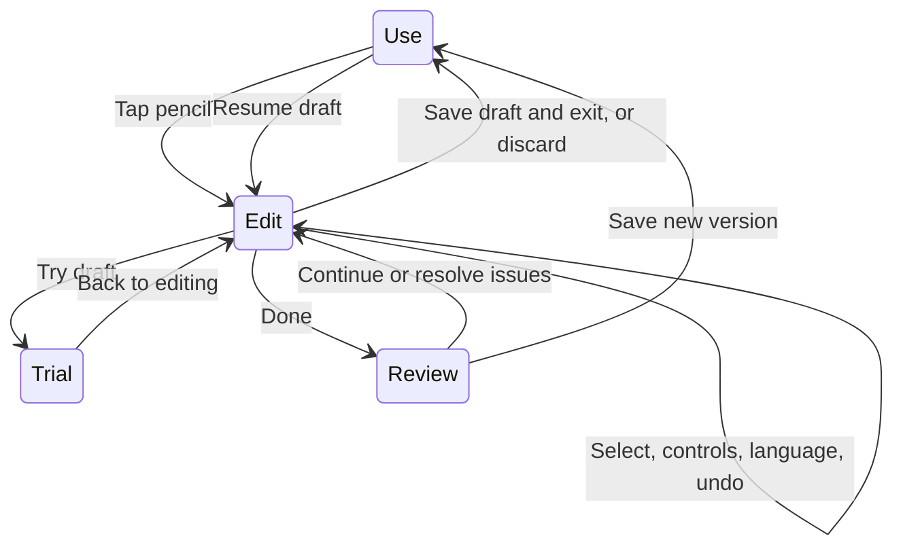

# Living Apps editing interaction design

**English** | [简体中文](APP_EDITING_INTERACTION.zh-CN.md)

Designed 2026-10-27; implementation updated 2026-10-28 for Android 0.2.0. The native editor is implemented and replaces the separate modification page for existing apps. The original phases remain below; where they describe future work, the actual status in this section takes precedence.

## 0.2.0 implementation status

| Capability | Implemented behavior |
|---|---|
| Use / Edit / Trial | The pencil opens EditorActivity; taps select objects in Edit; Trial uses isolated records; returning to Use preserves search and scroll position |
| Objects and nonmodal panel | Semantic selection of app, field, record-card template, statistics and preset actions; collapsed/half/expanded bottom panel; up/down ordering; selection outline and accessibility descriptions |
| Offline adjustments | Name, description, icon, color, density, start screen, title, statistics and unit label; add fields/options, defaults, groups and hidden fields. Apply commits text input to the draft |
| Persistent draft and conversation | SQLite stores definition, object, panel, input, relevant conversation, 30 undo/redo steps and trial copy; one live version per save. Independent draft storage revision prevents concurrent overwrites |
| API edit protection | Object and revision fixed at send time; actual differences validated; out-of-scope/late candidates retained for review; three-way merge and explicit same-property conflict choices; results ignored after cancellation. No live or trial records uploaded |
| Trial and commit | Shared native form, record-card and statistics renderers; temporary CRUD; copy up to 20 local records; restore unsubmitted trial input; recheck data impact and baseline before live commit |
| Automatic improvement | Active draft pauses automatic adoption, while observation continues; freezing, allowlist and cooldown remain; manual suggestions enter the same editor |
| Preset actions | AppSpec v2 supports up to six buttons that add a preset record on a user tap; trial, configuration and removal; date may use tap day; undo a newly added live record if it has not since been edited |
| Data conversion | Separate constrained type, explicit aggregate-number multiplier and complete option mapping flows; local preview, failure blocking, record fingerprint recheck, SHA-256 backup verification and transactional commit. Restore pre-conversion backups as independent app copies |

Arbitrary page styling, free-form layout, drawn annotations, multiselect, drag ordering, network/notification actions, conditional workflows, property-level optimization locks and budgets are not implemented. They require later component/capability extensions, not generated-code workarounds. Device keyboards, TalkBack and usability tasks with nonprogrammers remain pending; see [validation](VALIDATION.md).

Implementation mapping: `EditorActivity / EditorControls / ActionControls` handle interaction; `EditSession / EditChanges` handle drafts, differences, scope and merge; `RuntimeRenderer / TrialRecordStore` handle shared rendering and isolated trials; `MigrationPlan / MigrationControls / Store` handle local conversion. No business server was added.

Recommended flow: select an object inside the app, change it with controls or natural language, try the draft, then save a version. Ordinary Use remains the default. Organize editing around concrete phone tasks rather than code, component trees or development environments.

## Competitor interactions and choices

These interactions were verified in official documentation, not treated as hands-on device experience. All access dates: 2026-10-27.

| Product or source | Verified behavior | Choice for Living Apps |
|---|---|---|
| [Lovable preview toolbar](https://docs.lovable.dev/features/preview-toolbar) | Select preview elements as conversation context; edit text directly or annotate. Documentation says the toolbar replaces the former Visual edits experience | Adopt pointing to AI and selected-object references. Initially single selection and object hierarchy; annotations and multiselect later |
| [Replit Visual Editor](https://docs.replit.com/design/visual-editor) | Simple text, color and spacing edits are deterministic; complex changes go to an agent. The documented editor is web-browser-only | Split local controls from model work; use a mobile bottom panel. The document does not establish a solved in-phone editing experience |
| [Dreamflow Agent Panel](https://docs.dreamflow.com/workspace/agent-panel/) and [properties panel](https://docs.dreamflow.com/workspace/properties-panel/) | Selected widgets can enter agent context; Prompt Edit handles object-specific changes; properties have controls | Stable references and editable capabilities per object. Use understandable names such as amount input, not Flutter class names. Do not send screenshots by default |
| [Google Opal](https://developers.google.com/opal/overview) | Manual and natural-language edits both act on steps, with previews, step execution and version restoration | Two inputs edit one structure. Future behavior editing uses constrained step cards, without a mobile node-and-wire canvas initially |
| [Replit checkpoints](https://docs.replit.com/features/version-control/checkpoints-and-rollbacks) | Checkpoints restore project state; database restoration is separate and off by default | Distinguish app versions, editing drafts and records. UI restoration is not data restoration |

These references support mixed editing but do not prove the best interaction for this product. Choices below follow phone use, personal data and a constrained runtime. Microsoft's [human–AI interaction guidelines](https://www.microsoft.com/en-us/research/project/guidelines-for-human-ai-interaction/) also treat errors, correction and long-term interaction as explicit design stages; here they become undo, conflict handling and autonomous-change boundaries.

## Use and edit states

There are three user-visible states, without a separate permanent development workbench.

| State | Tap behavior | Writes | Top identification |
|---|---|---|---|
| Use | Normal app operation | Live business records | App name and pencil |
| Edit | Select an editable object without executing its business action | Local editing draft | Edit/draft status, Close and Done |
| Trial | Operate draft forms and buttons | Temporary trial data | Trial, no live record writes, Back to editing |

Only the pencil enters editing. Long press and double tap in Use keep their business meanings; no hidden gesture opens the editor. Exit restores the previous page, scroll position and filters.

## The phone editing screen

The top row is Close | Edit · App name | Done. Host editing controls replace the normal runtime toolbar, avoiding stacked return bars. The middle remains the actual app, interpreted from the draft by the same native renderer. A persistent nonmodal bottom panel leaves uncovered areas selectable.

The panel has collapsed, half and expanded states. Collapsed retains object and input entry; half shows common controls; expanded supports longer requests and impact review. A 64 dp collapsed height and approximately 40% half-height are experimental starting points, subject to device, font and keyboard testing.

Panel contents follow the object: name and scope, quick controls, language input and latest change explanation. Controls and natural language share one panel rather than two disconnected editors. Longer conversations may expand full-screen while preserving selection and context when collapsed.

When the keyboard opens, retain input and Send/Apply, scrolling the selected object into the remaining visible area. Allow a full-screen panel on constrained screens, with the object name retaining context. Back handles keyboard, expanded panel, Trial, then exit. Drafts autosave locally without repeated save prompts; explicit Discard draft deletes them.

## Selected objects and change scope

Each editable element has a semantic identity such as `form.field.amount`, not persistent screen coordinates. Hit testing chooses the most specific editable object; the panel shows a breadcrumb such as Record form › Amount input. Breadcrumbs select parents, and Pages and fields exposes otherwise hard-to-find fields.

Show outline, object name and impact scope together. Color alone is insufficient: a screen reader must communicate the selected amount input and its editable name/order. Noneditable runtime buttons can explain their purpose but must not open misleading, ineffective property panels.

| Tapped content | Actual target | Panel explanation |
|---|---|---|
| Category label in a form | Field display name | Form and displays referencing the name update together |
| One record card | Shared record-card template | Layout edits affect all record cards |
| Lunch inside a card | Display position of a record value | Editing the app does not change that record; offer an explicit Edit this record action |
| Total amount | Statistics configuration | Choose metric field or unit label without changing raw amounts |
| App name or color | App-level property | Applies throughout this sub-app |

Default scope is the selection. An explicit request to rename Amount and also make Statistics the start screen becomes two change groups, explained in the draft summary without an extra plan approval. Clarify only if a locked Only here scope conflicts with a broader request, or the request is ambiguous. Unrequested model changes are not authorized extensions.

Only here refers to a semantic editing object, not a single pixel area. Shared fields, card templates and global themes must disclose propagation accurately.

## Editing capabilities by task

| Task | Preferred interaction | Execution and feedback | Protocol requirement at design time |
|---|---|---|---|
| Rename app or field | Select, then type | Local undoable draft update | AppSpec v1 supports it |
| Reorder fields | Drag handle, with up/down alternative | Local preview, never arbitrary coordinates | v1 supports it |
| Change theme or density | Color and spacious/compact choices | Local, with app-wide impact shown | Limited v1 settings |
| Set start screen, title or metric | Select existing object | Local reference/numeric-type checks | v1 supports it |
| Add field or option | Add menu and concise configuration | Local or AI-assisted configuration | v1 can express it; a complete add UI was pending in the original design |
| Several adjustments together | Natural language with object references | API candidate, then validation and draft update | Command/scope validation layer |
| Hide/group fields or page styling | Constrained page structure | Preserve data and dependencies explicitly | Extend AppSpec before enabling |
| Tap to record 300 ml | Trigger and action cards | Simulate before live writes | Action protocol and capability permission |
| Network, reminders, cross-app reads | Capability configuration and permission | Explain destinations and costs | New capabilities, never arbitrary-code substitutes |

No unrestricted drag canvas initially. Constrained slots, ordering and presets adapt better across phones and match the runtime. New functionality is ultimately delivered by component and action extensions.

## Natural-language edits and ongoing conversation

The panel always shows the current reference, such as Category input; removing it permits a whole-app request. Rename it uses the selection. Changing selection must not silently retain the old reference. Sending fixes the reference in that message, independent of later selection changes.

Clear small requests generate candidates directly without mandatory plan approval. Validate protocol, scope, data compatibility and capabilities locally; then update the draft and summarize changes, preserved elements and Undo. Failed validation leaves the draft untouched.

Ask one concrete question for consequential ambiguity. Changing currency from yuan to cents must distinguish relabeling from converting every value. Conversion requires migration capability; if unavailable, explain that and retain the achievable unit-label edit. Relabeling must not be presented as numeric conversion.

Each successful AI edit is one undoable transaction. A follow-up such as keep the original color creates another edit, not a rollback of business records. Initially apply/undo interdependent groups together. Later partial adoption must check dependencies such as fields and metric references.

Show real stages: preparing context, waiting for model, checking changes, draft updated. No invented percentages. Cancellation ignores late results. Timeout, disconnection and invalid output preserve input/draft; users initiate retries. Local controls need no network; AI clearly requires it. Show usage returned by the gateway or configured pricing, never guessed costs.

## Drafts, trials and saving

One active draft per app includes baseline version, draft definition, edit transactions, references and relevant conversation. Autosave after successful operations and resume after restart; no project name is needed. Multiple edits become one live version only on Done and Save.

Undo/redo runs locally. Continuous typing groups into one text change, a drag into one ordering transaction and an AI request into one change transaction. Draft undo neither calls a model nor changes live records.

The editor may display current personal records read-only to judge actual layout. Trial uses temporary copies or clearly labeled example data; CRUD writes only to isolated trial storage. Leaving Trial or saving a version never copies trial records into live storage. Copy a few personal samples locally when needed, without uploading them.

Done presents changes, affected pages, data impact and unresolved checks. Cosmetic and compatible changes need one save, not a dialog per color or name. New required fields must show defaults and effects on existing records; unresolved conditions disable saving.

Save rechecks the draft baseline against the current version. If another operation changed the app, retain the draft and explain differences rather than overwriting with an old full definition. Initial choices are reapply against latest and keep draft/return. Reapplication still validates every change and requires explicit same-property conflict choices.

## Data structure changes

Definitions and records are separate; version restoration restores definitions only. Added fields, defaults and types affect interpretation and require dedicated checks.

| Change | Handling in the original/current phase plan | Explanation |
|---|---|---|
| Rename/reorder field | Allowed, stable ID unchanged | Historical content remains |
| Add optional field | Allowed | Empty in old records, without fabricated values |
| Add required field | Valid default required | Explain fallback reads for missing old values, not refilling history |
| Optional becomes required | Check default and existing explicit nulls; block unresolved cases | Treat missing and intentionally cleared values separately |
| Remove existing option | Block in ordinary editing | Later archive/map rather than forcibly recategorizing history |
| Change field type | Block in ordinary editing | Separate migration preview shows successes, failures and nulls |
| Hide field/component | Requires protocol extension; preserve data and metric references | Distinguish visibility from deletion |
| Convert unit and values | Separate migration plan, not ordinary editing | Explicit conversion rule, not just unit text |
| Delete app or record | Explicit data-management entry | Excluded from routine UI editing and autonomous optimization |

Hiding a required input must leave a valid source for new values; without a valid default or other explicit source it is blocked. Removing metric display differs from deleting its underlying field; references must remain valid.

Impact counts come from local scans; prototype numbers are examples. If records change before save, rerun data checks. Migration also needs verifiable backups, dry runs and atomic commits; high-impact operations open only with those capabilities. Restoring old UI cannot undo deleted records.

## Autonomous improvement uses the same editing system

Suggestions present observation evidence, proposed change, impact scope and preview. Opening one enters an ordinary draft labeled Local suggestion, which the user can continue editing. There is no update path bypassing editing checks.

An unfinished draft pauses automatic adoption while events continue. Saving or discarding restores the prior setting, preventing background baseline changes during AI requests. Save-time version checks still handle changes from other sources such as restoration.

Initially only adding quick entry is allowlisted, subject to app freezing and a 24-hour cooldown. The system must not reverse user edits as optimization. Later local locks and Stop suggesting this restrictions follow semantic properties, not coordinates. Insufficient samples produce an insufficient-observation message, not improvement percentages.

## Native structure and local computation

At design time MainActivity combined runtime, editing and preview. The next step was to extract shared rendering and sessions rather than keep adding panels to one Activity. All new editing computation stays on the phone; LLMs use configured APIs only. The implementation status above names the extracted classes actually delivered.

| Module in the design | Responsibility | Execution |
|---|---|---|
| RuntimeRenderer | Same AppSpec for Use/Edit/Trial, mode-specific listeners | Phone |
| EditBindingRegistry | Semantic objects, properties, scope, descriptions, capabilities | Phone |
| EditSession and DraftRepository | Baseline, draft, request revision, transactions, crash recovery | Phone SQLite |
| EditCommandExecutor | Constrained rename, reorder, switches and optional-field commands | Phone |
| ChangeAnalyzer | Complete differences, scope, compatibility, dependencies, impact counts | Phone |
| PreviewRecordStore | Trial writes isolated from live storage | Phone |
| EditorSheet | Panel, controls, object references and conversation | Phone |
| ResponsesClient | Requirements, necessary definition and references; candidate response | Phone directly to remote API |
| MigrationPlanner | Future conversion preview, backup and atomic commit | Phone; migration exposed only after implementation |

Controls and AI results share command execution and validation. The current model returns a full AppSpec; during transition, derive semantic commands from before/after definitions and validate actual scope. The model's claim that it only changed a color is not authorization; actual differences determine scope.

Requests bind at least `appId`, `baseVersionId`, `draftRevision`, `selectionRefs`, allowed capabilities and scope. If the revision changes before response, retain a review candidate rather than overwriting local work. Initially allow one model request per draft with cancellation. Local edits may continue, but conflicts must be recalculated. Avoid arbitrary parallel branches and automatic merging initially.

AppSpec v1 has app-level colors and limited layout settings, not arbitrary button labels, typography, visibility or custom actions. Generate controls from the capability registry; do not promise edits the protocol cannot express. Extend page trees, theme properties and actions separately, each with compatibility and runtime validation.

Requests continue to include `store:false`, without silent model changes. Send requirements, necessary structure, selection and relevant conversation; no raw records, typing events, credentials or automatic screenshots. Definitions may themselves contain personal input; explain this destination too. Future screenshot attachments must be selected and previewed by users.

## Reusable open-source projects

This design/review stage did not add APK dependencies.

| Project and verified version | License | Decision |
|---|---|---|
| [Puck v0.21.0](https://github.com/puckeditor/puck/tree/v0.21.0), commit `21470257d1f520c9b50f61196f1f02fc267c3912` | [MIT](https://github.com/puckeditor/puck/blob/v0.21.0/LICENSE) | Reference component configuration, data-driven editing and undo history. No embedding of the React editor or its cloud AI service in native Android |
| [Material Components Android 1.13.0](https://github.com/material-components/material-components-android/releases/tag/1.13.0) | [Apache 2.0](https://github.com/material-components/material-components-android/blob/1.13.0/LICENSE) | Evaluate standard nonmodal BottomSheetBehavior first; modal sheets only for confirmation/full impact review. Validate themes, keyboard, Back and package size before integration |
| AndroidX ItemTouchHelper | Recheck source license for the eventually selected version | Official API confirms list dragging; retain dependency-free up/down controls, with no new version selected or integrated |

Material's [bottom-sheet documentation](https://github.com/material-components/material-components-android/blob/1.13.0/docs/components/BottomSheet.md) distinguishes standard and modal sheets. Standard sheets coexist with selectable content. Puck's [history API](https://puckeditor.com/docs/api-reference/components/puck) informs session history; browser implementations are not automatically reusable native code.

## Delivery phases

Phase one prioritizes session reliability: retain AppSpec v1, share rendering, add semantic binding, local persistent drafts, undo/redo, rename/order/layout controls, isolated trials, complete differences and conflict checks. Adapt existing model output into the session before expanding generation.

Phase two expands expression: selected references in conversation, field adders, page/field lists, constrained groups, complete option/default editing. Design protocol extensions and migration before visibility controls. Explain partial change-group adoption and keep dependency checks.

Phase three adds behavior and personal adaptation: constrained trigger/condition/action cards with permission and simulation per capability; conversion, property locks, budgets and reminders. Annotations, multiselect, free layouts and workflow wiring must not displace phase-one reliability.

## Acceptance and validation plan

These are the original acceptance goals. Executed 0.2.0 core, framework, SQLite and native interaction checks are in [validation](VALIDATION.md); device and nonprogrammer usability testing remain pending.

1. Without API/network, rename, reorder, adjust theme/layout presets and undo/redo; selection matches actual scope.
2. Trial CRUD leaves live storage unchanged before/after save; restoring versions preserves later live records.
3. Input, selection, panel, draft and history survive rotation/process reconstruction; only explicit discard deletes a draft.
4. Extra model changes require scope expansion or rejection, never silent overwrite; cancelled/late responses do not mutate the draft.
5. Local changes during generation survive returned results; baseline changes do not lose the draft.
6. Required fields, explicit nulls, option removal and type changes cover valid, invalid and partially compatible records, with understandable object names in errors.
7. Device checks cover 320 dp, common screens, 1.3× and larger fonts, keyboards, TalkBack and Back gestures. Primary actions remain reachable and dragging is not the sole reorder method.
8. Invite nonprogrammers to rename, add a field, try, undo and restore. Measure completion, accidental data changes, scope misunderstandings, help requests and model calls. Validate understanding before tuning panel height and flow.

The design-stage web prototype uses preset examples, without models or personal data. The Android implementation is EditorActivity, independently validated for storage, framework and live API behavior; the web prototype is not the APK.

At design time Chromium checks covered prototype rename, undo/redo, scope confirmation, isolated trial, saving, conversation entry, cancellation, fixed send-time selection, stale-result rejection and narrow/dark views. These verify prototype interactions, not Android, model or real-storage acceptance.

## A second creation mode: reconstruct an installed app

The home screen now offers creation from scratch and reconstruction of an installed app. Reconstruction uses source-page selection and demonstration rather than record-field editing: choose source → explicit authorization → select text/lists/operations → arrange appearance → try on device → confirm the result. Fixed workflows, compatibility states and restoration are documented in [Rebuild mode](REBUILD_MODE.md). The existing record editor remains independent.
