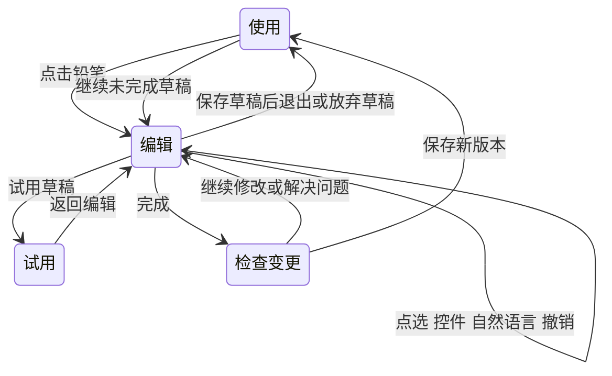

# 生长应用编辑交互方案

[English](APP_EDITING_INTERACTION.md) | **简体中文**

设计日期：2026-10-27；实现更新：2026-10-28，Android 0.2.0。原生编辑器已经落地，取代已有应用的独立修改页。下文保留原方案的阶段安排；涉及“后续”“拟实现”的范围，以本节的实际状态为准。

## 0.2.0 实现状态

| 方案能力 | 已实现的具体行为 |
|---|---|
| 使用 / 编辑 / 试用 | 正常使用点击铅笔进入 EditorActivity；编辑点选对象；试用使用隔离记录；返回原使用页并保留搜索与滚动位置 |
| 对象与非模态面板 | 应用、字段、记录卡片模板、统计和固定动作的语义选择；底部面板收起 / 半屏 / 展开；上移下移排序；选中轮廓与无障碍说明 |
| 离线调整 | 名称、说明、图标、颜色、密度、首页、标题、统计、单位标注；新增字段、选项追加、默认值、分组、隐藏。文字输入点击“应用”进入草稿 |
| 连续草稿与对话 | SQLite 持久化定义、对象、面板、输入、相关对话、30 步撤销重做及试用副本；每次正式保存形成一个版本。草稿写入使用独立存储修订号防止并发覆盖 |
| API 修改保护 | 发送时固定对象与修订号；校验实际差异；越界或迟到候选留待检查；三方合并并显式选择同属性冲突；取消后忽略结果。不上传正式或试用记录 |
| 试用与提交 | 与正式应用共用原生表单、记录卡片和统计渲染器；临时新增 / 修改 / 删除、复制本机最多 20 条；未提交的试用输入可恢复；正式提交重新检查数据影响与基线 |
| 自动优化 | 草稿存在时停止自动采用，继续收集观察；保留冻结、允许列表和冷却；手动建议进入相同编辑器 |
| 固定动作 | AppSpec v2 最多 6 个“用户点击后新增一条预设记录”按钮；可试用、配置和移除；日期支持点击当天；正式执行后可撤销刚才未再编辑的记录 |
| 数据转换 | 独立入口支持受限类型转换、累计数字项的显式倍率换算、完整选项映射；本机演算、失败阻止、记录指纹复查、SHA-256 备份校验、事务提交。转换前备份可恢复为独立应用副本 |

当前没有任意页面样式、自由布局、画笔标注、多选、拖拽排序、联网 / 通知动作、条件工作流、属性级自主优化锁和预算配置。这些仍属于后续组件与能力扩展，不能通过生成代码绕开。设备键盘、TalkBack 与非开发者可用性任务尚待真机 / 用户验证，详见 [验证报告](VALIDATION.zh-CN.md)。

实现映射：`EditorActivity / EditorControls / ActionControls` 负责交互；`EditSession / EditChanges` 负责草稿、差异、范围与合并；`RuntimeRenderer / TrialRecordStore` 负责共用渲染和隔离试用；`MigrationPlan / MigrationControls / Store` 负责本地数据转换。没有新增业务服务器。

建议采用“在应用中选对象，用控件或自然语言修改，在草稿里试用，完成后保存版本”的主流程。普通使用始终是默认状态。编辑器围绕手机上的具体任务组织，而不是要求用户理解代码、组件树或开发环境。

## 竞品交互及取舍

以下为官方文档核实的交互，未将宣传页描述视为实际设备体验。访问日期均为 2026-10-27。

| 产品或资料 | 已核实的做法 | 对生长的取舍 |
|---|---|---|
| [Lovable 预览工具栏](https://docs.lovable.dev/features/preview-toolbar) | 在预览里选元素作为对话上下文；可直接改文字，也可画标注。当前文档说明工具栏已取代旧 Visual edits 体验 | 采用“指给 AI 看”和选中对象引用。手机首版保留单选与对象层级，标注、多选放到后续 |
| [Replit Visual Editor](https://docs.replit.com/design/visual-editor) | 简单文字、颜色、间距通过确定性编辑直接更新；复杂修改转 Agent。当前明确仅 Web 浏览器支持此编辑器 | 采用本地控件与模型分工。移动端采用底部面板；该文档不能证明它已解决手机内编辑体验 |
| [Dreamflow Agent Panel](https://docs.dreamflow.com/workspace/agent-panel/) 与 [属性面板](https://docs.dreamflow.com/workspace/properties-panel/) | 当前选中 Widget 可带入 Agent；Prompt Edit 支持针对对象的小修改，属性有对应编辑控件 | 为每个对象提供稳定引用与可编辑能力。用用户能理解的“金额输入项”等名称，不展示 Flutter Widget 类名；截图默认不发送 |
| [Google Opal](https://developers.google.com/opal/overview) | 手工编辑和自然语言编辑都作用于步骤；支持预览、步骤运行与版本恢复 | 借鉴“两种输入修改同一个结构”。行为编辑以后使用受约束步骤卡，手机首版不引入节点连线画布 |
| [Replit 检查点](https://docs.replit.com/features/version-control/checkpoints-and-rollbacks) | 检查点能恢复工程状态；数据库恢复是独立选项，默认回退不改数据库 | 生长明确区分应用版本、编辑草稿与记录，不把恢复界面包装成恢复数据 |

这些资料支持采用混合编辑，但不证明某种交互一定最适合本产品。以下选择依据本产品的手机场景、个人数据和受约束运行时作出。Microsoft 的[人机 AI 交互指南](https://www.microsoft.com/en-us/research/project/guidelines-for-human-ai-interaction/)亦将出错、纠正及长期交互视为需要专门设计的阶段；本方案把它们落实为撤销、冲突处理和自主优化边界。

## 使用和编辑状态

产品只有三个用户可见状态，不再增加一个长期独立的“开发工作台”。

| 状态 | 单击界面元素 | 写入位置 | 顶部标识 |
|---|---|---|---|
| 使用 | 正常操作应用 | 正式业务记录 | 应用名称及铅笔入口 |
| 编辑 | 选中可修改对象，不触发原业务按钮 | 本地编辑草稿 | 编辑及草稿状态，关闭和完成 |
| 试用 | 按草稿操作表单和按钮 | 临时试用数据 | 试用，记录不会保存到正式应用；返回编辑 |

点击铅笔才进入编辑。运行状态的长按、双击继续服从正常业务，不用隐藏手势打开编辑器。退出后回到原来的使用页面、滚动位置和筛选状态。

## 手机上的编辑界面

顶部为“关闭｜编辑·应用名｜完成”。宿主编辑栏替换正常运行时的编辑工具栏，避免叠放两排返回按钮。中间仍显示实际应用，用同一原生渲染器解释草稿定义。底部是常驻、非模态的编辑面板，画面没有被遮住的部分仍可点选。

底部面板有收起、半展开和全展开三个状态。收起时只保留当前对象与输入入口；半展开显示常用控件；输入长需求或查看影响时全展开。初始可用 64 dp 收起高度、约四成屏幕的半展开作为试验起点，最终依真机、字号和键盘测试调整。

面板的内容随对象变化，常见部分为：对象名称和影响范围、快捷调整、自然语言输入、最近一次修改说明。控件调整和自然语言在同一面板里，不形成两个互不相通的编辑器。复杂连续对话可以全屏展开，收起后保留当前选中对象和上下文。

键盘出现后保留输入框、发送或应用按钮，并将选中元素滚到仍可见的区域；屏幕不足时允许切成全屏面板，用对象名称维持上下文。返回键依次处理键盘、展开面板、试用状态、退出编辑。草稿自动保存在本机，离开时不要求反复确认保存；主动“放弃草稿”才删除它。

## 选中对象与修改范围

每个可修改元素附带语义身份，例如 `form.field.amount`，而不是用屏幕坐标作为持久引用。点击命中最具体的可编辑对象，面板显示“记录表单 › 金额输入项”。点面包屑可以改选上一级；找不到的字段通过“页面与记录项”列表进入。

选中轮廓、对象名称和影响范围同时出现。只依赖颜色不够，屏幕阅读器也要能读出“已选中金额输入项，可修改名称和顺序”。不支持修改的运行时按钮仍可解释其作用，但不能打开一个看似能改、实际无效的属性面板。

| 点中的内容 | 实际目标 | 面板应说明什么 |
|---|---|---|
| 表单的“分类”标签 | 数据字段的显示名称 | 表单和引用该名称的显示处会一起更新 |
| 一张记录卡片 | 重复使用的记录卡片模板 | 布局调整影响所有记录卡片 |
| 卡片中的“午饭” | 记录值所在的显示位置 | 编辑应用时不会改掉这条记录内容；可显式转到“编辑这条记录” |
| 累计金额 | 统计配置 | 选择统计字段或单位标注，不改原始金额 |
| 应用名称或颜色 | 应用级属性 | 应用于整个子应用 |

默认范围为所选对象。用户明确提出“修改金额名称，顺便把首页改成统计”时，按已经表达的意图拆成两组修改，在草稿摘要里说明范围，不额外要求计划审批。若用户固定了“只改这里”，却又提出需要更大范围的要求，或请求本身有歧义，才澄清冲突。模型自行改到未请求的对象时，不把它当作已获授权的扩展。

“只改这里”指编辑语义上的对象，不保证只影响一个像素区域。共享字段、卡片模板、全局主题必须如实显示传播范围。

## 按任务组织编辑能力

| 用户任务 | 首选交互 | 执行与反馈 | 对当前协议的要求 |
|---|---|---|---|
| 改应用名或字段显示名 | 点选后输入文字 | 本机更新草稿，可撤销 | AppSpec v1 已能表达 |
| 改字段顺序 | 列表拖动把手，上移下移按钮作替代 | 本机实时预览；不允许拖成任意坐标 | v1 已能表达 |
| 改主题或布局密度 | 颜色与舒展紧凑选项 | 本机更新；显示应用级影响 | v1 已能表达有限选项 |
| 改默认首页、列表标题、统计字段 | 选择现有对象 | 本机检查引用和数字字段类型 | v1 已能表达 |
| 新增记录项、增加选项 | 添加菜单和简短配置 | 本机创建，或用 AI 帮忙填配置 | v1 可表达，当前 UI 尚无完整添加器 |
| 一次提出几个调整 | 自然语言加对象引用 | API 返回候选，验证后更新草稿 | 需要命令与范围校验层 |
| 隐藏字段、分组、按页设置样式 | 受约束的页面结构编辑 | 明确保留数据和依赖 | 扩展 AppSpec 后再开放 |
| “点一下记录 300 ml”等动作 | 触发条件与动作卡片 | 先模拟，不触发正式写入 | 需要动作协议和能力授权 |
| 联网、提醒、跨应用读取 | 能力配置及授权 | 清楚呈现数据去向和费用 | 需要新增能力，不用任意代码替代 |

首版不提供任意拖拽画布。受约束的槽位、顺序和布局预设更容易适配不同手机，也符合当前运行时。用户真正需要新增的功能，最终由组件和动作能力扩展承接。

## 自然语言修改与连续对话

面板始终显示本次对象引用，例如“分类输入项”，用户可移除它以提出整体要求。选中对象后输入“换个名字”依赖该对象；再次选择另一个对象时不把旧引用偷偷带过去。发送后将所用对象引用固定在该条消息中，后续切换选择不改变在途请求。

明确的小请求直接生成候选，不先强制进行计划审批。收到结果后，本地检查协议、修改范围、数据兼容和能力清单，通过后更新草稿，并呈现“改了什么／保留了什么／撤销”摘要。候选没有通过检查时，当前草稿保持原样。

重要歧义先问一个具体问题。例如“金额从元改成分”必须区分只改显示单位和换算所有金额。选择“换算金额”需要数据迁移能力；该能力未实现时明确解释，并保留可以完成的单位标注修改。不能把换单位当作已完成数值转换。

每条成功的 AI 修改作为一个可撤销事务。用户继续说“颜色保留原来的”，产生一条新修改，不把对话回退误当成业务记录回退。第一阶段对一个相互依赖的修改组整组采用或撤销；以后允许拆组采用时，必须连同字段与统计引用等依赖一起检查。

生成过程采用真实状态“准备上下文／等待模型／检查修改／已更新草稿”，不显示虚假的百分比。取消后忽略迟到结果；超时、断网、输出错误均保留输入和草稿，重试由用户发起。普通控件无需联网；AI 入口标明需联网，费用只展示网关实际返回的用量或已配置价格，不猜测金额。

## 草稿 试用和保存

一个应用同时保留一个活动草稿，内部包含基线版本、草稿定义、编辑事务、对象引用和相关对话。草稿在每次成功操作后自动保存，重启时可继续；用户不需要先取一个“工程名称”。草稿多次操作只在点击完成并保存时产生一个正式版本。

草稿内撤销和重做在手机本地完成。连续打字合并成一次文字修改，拖动一次形成一次排序事务，一条 AI 请求形成一次修改事务。草稿内撤销不调用模型，也不改变正式记录。

编辑画面可在本机只读显示当前个人记录，便于判断真实排版。进入试用后使用临时数据副本或明确标注的示例数据；新增、修改、删除均落入隔离的临时记录库。退出试用或保存应用版本都不把这些试用记录带入正式库。需要用自己的样本试用时，由本机复制少量记录，不上传给模型。

完成时呈现一张简洁的变更检查页：发生的变化、受影响的页面、数据影响、是否有未通过项。纯外观和兼容修改只需一次保存；不为每个颜色和字段名称弹窗。新必填项等涉及既有记录解释的修改必须显示默认值和影响范围，条件未解决时保存不可用。

保存时再次比较草稿基线与当前版本。若其他操作已经更新应用，保留草稿并解释差异；不以较旧的完整定义覆盖新版本。初期提供“基于最新版重新应用修改”和“保留草稿返回”两个选择；重新应用仍要逐项校验，同一属性冲突必须给出明确选择。

## 数据结构变更的交互

应用结构与记录独立，版本恢复只恢复定义。新增字段、默认值和类型变更会改变如何解释记录，必须单独检查。

| 修改 | 当前或下一阶段处理 | 用户看到的解释 |
|---|---|---|
| 改字段显示名、排序 | 允许，稳定 ID 不变 | 历史内容保留 |
| 新增可选字段 | 允许 | 旧记录该项为空，不伪造内容 |
| 新增必填字段 | 必须先有有效默认值 | 说明旧记录缺失时如何读取，不把它说成重新填写过 |
| 把可选项改必填 | 检查有效默认值和既有显式空值；未解决则阻止提交 | 缺失值和用户主动清空的值分别处理 |
| 删除已有选项 | 现阶段阻止 | 后续提供归档或映射，不强行改已有记录的类别 |
| 改字段类型 | 现阶段阻止 | 后续先展示转换成功、失败和空值数量，形成独立迁移计划 |
| 隐藏字段或组件 | 协议扩展后支持；保留数据及计算引用 | “不显示”与“删除数据”分开 |
| 换单位并转换数值 | 需要独立迁移计划，当前不开放 | 明确换算规则，不能只有单位文字变化 |
| 删除应用或记录 | 留在明确的数据管理入口 | 不混入普通界面编辑和 AI 自主优化 |

隐藏必填输入还要检查新记录是否仍能得到合法值；没有有效默认值或其他明确来源时不能隐藏。移除布局中的统计展示与删除底层统计字段分别处理，引用仍须有效。

影响数量都由本机扫描当前记录计算，示例原型中的数字只是示例。保存前若记录已变化，数据相关检查重新运行。数据迁移还需可验证备份、临时演算和事务性提交；只有补齐这些能力后才开放高影响操作，不能承诺恢复旧 UI 就能撤销记录删除。

## 自主优化使用同一套编辑机制

系统建议以“观察依据、建议改动、影响范围、预览”呈现。点开建议后进入普通草稿，修改来源标成“本机建议”，用户可以继续编辑。系统不另开一个绕过编辑检查的更新通道。

同一应用存在未完成草稿时，暂停自动采用，继续收集使用事件；保存或放弃草稿后恢复原设置。这样可避免 AI 请求期间基线被后台改动。保存时的版本检查仍必须保留，以处理恢复版本等其他来源的变化。

第一阶段沿用当前自动允许列表：仅增加快速记录入口，服从应用冻结与 24 小时冷却。人工编辑的目标不因此被系统反向优化。后续增加局部锁定和“不再建议这项”时，按语义属性记录限制，而非按屏幕坐标记录。没有足够使用样本时只显示观察不足，不生成改善百分比。

## 原生实现结构与本地计算

目前 MainActivity 集中了运行、编辑和预览，下一阶段应先抽出共用渲染器和编辑会话，避免把新面板继续塞进一个 Activity。所有新增编辑能力仍在手机执行，LLM 仅通过已配置 API 调用。

| 模块 | 职责 | 执行位置 |
|---|---|---|
| RuntimeRenderer | 用同一 AppSpec 渲染使用、编辑和试用；依据模式注入监听器 | 手机 |
| EditBindingRegistry | 语义对象、可编辑属性、影响范围、说明和能力列表 | 手机 |
| EditSession 和 DraftRepository | 基线、草稿、请求修订号、事务历史、崩溃恢复 | 手机 SQLite |
| EditCommandExecutor | 执行改名、排序、开关、增加可选字段等受约束命令 | 手机 |
| ChangeAnalyzer | 完整差异、范围越界、兼容性、依赖和记录影响计数 | 手机 |
| PreviewRecordStore | 与正式库隔离的试用写入 | 手机 |
| EditorSheet | 底部面板、属性控件、对象引用和连续对话 | 手机 |
| ResponsesClient | 发送需求、必要定义和语义引用，返回候选 | 手机直连远端 API |
| MigrationPlanner | 后续的转换演算、备份与事务提交 | 手机；实现后才开放迁移 |

控件修改与 AI 返回都进入同一个命令执行与检查层。当前模型仍返回完整 AppSpec，过渡期可以先把前后定义解析成语义命令，再验证其是否超出本次目标；模型“说明只改了颜色”不具有授权效力，实际差异才是依据。

编辑请求至少绑定 `appId`、`baseVersionId`、`draftRevision`、`selectionRefs`、允许能力和范围。请求返回时若草稿修订号改变，保存结果为待检查候选，不能覆盖用户刚做的本地修改。初期同一草稿最多一个模型请求，允许取消；本地操作可继续，但返回结果需重算冲突。避免同时实现任意并行分支和自动合并。

AppSpec v1 只有应用级配色和几项布局设置，按钮标题、任意字号、组件显示隐藏及自定义动作尚未建模。选择层必须从能力注册表生成控件；当前无法表达的属性不对外承诺可编辑。页面树、主题属性和动作协议分别扩展，每次扩展都要有兼容策略和运行时验证。

API 请求继续包含 `store:false`，不静默换模型。默认发送描述、必要应用结构、选中对象与相关对话；不发送原始记录、键盘输入事件、凭据或自动截屏。应用和字段定义本身也可能含用户输入的信息，数据去向说明应包含这一点。截图附件如以后开放，需用户主动选择并预览发送内容。

## 可复用开源项目

本轮只设计与评估，不增加 APK 依赖。

| 项目与核实版本 | 许可 | 决定 |
|---|---|---|
| [Puck v0.21.0](https://github.com/puckeditor/puck/tree/v0.21.0)，commit `21470257d1f520c9b50f61196f1f02fc267c3912` | [MIT](https://github.com/puckeditor/puck/blob/v0.21.0/LICENSE) | 参考组件配置、数据驱动编辑和撤销历史。React 编辑器不直接嵌入原生 Android；不引入它的云 AI 服务 |
| [Material Components Android 1.13.0](https://github.com/material-components/material-components-android/releases/tag/1.13.0) | [Apache 2.0](https://github.com/material-components/material-components-android/blob/1.13.0/LICENSE) | 优先验证标准非模态 BottomSheetBehavior；模态弹层只用于确认或完整影响检查。现有系统 Material 主题与 AndroidX 主题、键盘、返回手势和包体需先做小型集成验证 |
| AndroidX ItemTouchHelper | AndroidX 源码许可需随最终选定版本再次核对 | 已核实官方 API 支持列表拖动；当前保留上移下移作为无依赖路径，尚未选择或集成新版本 |

Material 的[标准底部面板说明](https://github.com/material-components/material-components-android/blob/1.13.0/docs/components/BottomSheet.md)区分标准与模态面板；前者可与主画面并存，更符合继续点选元素的需求。Puck 的[历史 API](https://puckeditor.com/docs/api-reference/components/puck)可供会话历史设计参考，不将浏览器实现等同于原生可直接复用。

## 分阶段落地

第一阶段优先解决编辑会话可靠性。保持 AppSpec v1，完成渲染器复用、语义绑定、本地持久草稿、撤销重做、改名排序和布局控件、隔离试用、保存前完整差异及冲突检查。把当前模型返回适配到同一会话，不先扩大生成能力。

第二阶段增强表达。增加连续对话中的对象引用、字段添加器、页面和字段列表、受约束分组、完整选项和默认值编辑。隐藏属性等先设计 AppSpec 扩展和迁移，再开放交互。可解释地采用部分修改组，保留依赖校验。

第三阶段再增加行为和个人适应。用受约束动作卡表示触发、条件、动作，逐项增加权限和模拟能力；加入数据迁移、属性锁定、预算与提醒。画图标注、多选、任意布局和工作流连线不挤占第一阶段的可靠性工作。

## 验收与验证计划

以下保留设计时的验收目标。0.2.0 已执行的核心、Android 框架、SQLite 和原生界面检查详见 [验证报告](VALIDATION.zh-CN.md)；真机与非开发者可用性测试仍待执行。

1. 不接 API、不联网，也能完成改名、排序、主题及布局预设调整、撤销和重做；选中对象与实际改动范围一致。
2. 试用中新增、编辑、删除记录，正式库在保存前后保持不变；恢复应用版本后新产生的正式记录仍保留。
3. 输入、选择、面板状态、草稿和事务历史在旋转及进程重建后恢复；主动放弃才删除草稿。
4. 模型返回多改了未选择的对象时，提示扩大范围或拒绝越界，不默默覆盖；取消和迟到响应不会改变草稿。
5. 生成过程中用户又做了本地修改，返回结果不会覆盖该修改；基线变化时仍可找回完整草稿。
6. 新必填字段、显式空值、选项移除和类型变化覆盖有效、无效及部分记录兼容的情况；错误说明用用户能理解的名称。
7. 真机检查 320 dp、常用屏幕、1.3 倍及更大字号、键盘、TalkBack、返回手势。主操作可触达，不把拖动作为排序唯一入口。
8. 邀请一组无编程经验用户完成改名、添加记录项、试用、撤销和恢复五项任务。记录完成率、误改数据次数、误解范围次数、求助与模型调用次数；先验证是否理解，再据此调整面板高度和流程。

设计阶段的网页交互示意使用预设示例，不调用模型，也不连接真实个人数据。当前 Android 实现为 EditorActivity，独立接受存储、框架和真实 API 回归验证，没有将网页示意当成 APK。

本轮已在 Chromium 浏览器中检查示意的本地改名、撤销重做、范围确认、隔离试用、保存、对话入口、取消、发送时固定对象、陈旧结果拦截及窄屏深色显示。它们验证的是示意交互，不代替上述 Android、实际模型和真实存储验收。

## 第二种创建模式：重构已安装应用

首页并列提供从零创建与重构已有应用。重构通过原页面选取和示范建立能力，不复用记录字段编辑：选择来源 → 明确授权 → 选取信息/列表/操作 → 设计界面 → 本机试用 → 核对结果。固定流程、兼容状态和恢复详见[重构模式](REBUILD_MODE.zh-CN.md)。现有记录编辑器保持独立。
