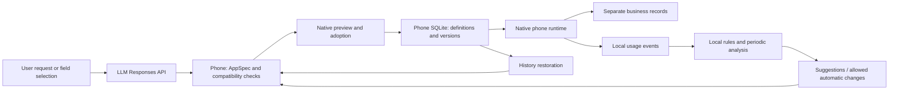

# Living Apps — Local-first Android development plan

**English** | [简体中文](DEVELOPMENT_PLAN.zh-CN.md)

Updated 2026-10-28. Version 0.2.0 implements the native app-editing workspace; device acceptance remains separately tracked.

## Product scope

One host app, multiple personal sub-apps. Create and edit through natural language, run through native phone UI, and derive suggestions from actual usage events. The initial runtime covers records, lists, check-ins, forms and statistics. It never executes arbitrary LLM-generated code. Complex games, third-party account connections and cross-device synchronization are outside the initial runtime.

Initial loop: library → creation/template → offline use and records → on-device observation → proposed change → compatibility checks and preview → apply version → observe outcomes/restore.

## Computation deployment decisions

| Work | Location | Reason and data boundary |
|---|---|---|
| Sub-app layout and forms | Phone | Native components interpret validated JSON; no remote webpage dependency |
| Record CRUD, statistics, search | Phone SQLite | Personal records are not uploaded |
| Usage events, timing, errors, aggregation | Phone | Event name, version and duration only; no typed content |
| Recognize frequent entry points and low-risk rules | Phone | Deterministic rules suffice, without LLM costs |
| Versions, candidates, compatibility, restoration | Phone | Atomic definition changes; business records stored separately |
| Editing panel, semantic selection, undo/redo, drafts, merge | Phone / SQLite | Input and conversation persist locally; APIs receive necessary context only; concurrent writes and late results checked separately |
| Trial forms, preset actions, temporary records and statistics | Phone | Shared renderer; trial writes stay in a separate draft copy; actions execute only on user taps |
| Type/numeric/option conversion and pre-conversion backups | Phone background thread / SQLite | Fixed converters, data fingerprint rechecks, SHA-256 verification and transactional commit; no server needed |
| Deferred background analysis | Phone JobScheduler | Android schedules it; no promise of exact timing or execution after force stop |
| Natural-language generation and editing | Remote LLM API | Phone calls Responses directly, sending requirements and current definition |
| Optional deeper LLM analysis | Remote LLM API | User initiated; app definition and aggregate behavior summary only, no raw records |
| Model discovery, error handling, JSON validation | Phone | Local handling preserves the usable version on failure |
| Dedicated business backend | Not needed initially | Introduce only for concrete needs such as account sync, collaboration or centralized billing |

Local-first means app execution and personal data stay on the device. All LLMs use APIs as requested; no large model runs on the phone. How the API gateway itself operates is outside this project's control.

## Architecture

- Android 8.0+; native Java and Android Views. Reuse the SDK, SQLite, JobScheduler and Keystore; no JavaScript engine or cloud build service initially.
- AppSpec v1/v2: stable field IDs, types, title, options, defaults, metric field and limited layout. v2 adds groups, hidden fields and constrained preset actions.
- Store: apps, versions, records, events, proposals, drafts and conversion backups. SQLite v1/v2 upgrades to v3 preserve data; transactions and draft CAS prevent overwrites. Conversion uses data_epoch, blocking direct restoration across a conversion.
- EditorActivity + EditSession + EditChanges: native editing, scope checks, ongoing conversation, isolated trials, three-way merge and version commits.
- SpecValidator + Compatibility: reject arbitrary code, unknown components, removal of existing fields, incompatible type changes and other incompatible edits.
- ReflectionEngine: local rules produce candidates from actual events. Only user-enabled allowlisted adjustments apply automatically; historical versions remain.
- ResponsesClient: configurable base URL and model discovery; `store:false`; authenticated redirects are not followed automatically; errors are sanitized.
- SecretVault: API keys encrypted with Android Keystore AES-GCM in private storage, excluded from APK, source and exported backups.

## Implementation checkpoints

- [x] Inspect workspace and local Android build environment
- [x] Review open-source references for dynamic UI, forms and reflection
- [x] Implement definitions, compatibility validation and meaningful JVM tests
- [x] Implement SQLite storage and independent version history
- [x] Implement host UI, templates, runtime, records and statistics
- [x] Implement local observation, suggestions, allowed automatic changes and restoration
- [x] Integrate Responses; verify the target model, real generation and second-round editing
- [x] Build APK and run lint; core, editor, storage and conversion tests executed, with counts in the validation report
- [x] Native editing, persistent drafts, isolated trials, merging, preset actions and constrained conversion
- [x] Complete guides, open-source reviews and validation report
- [ ] Connect a physical device and test power policies, Keystore, system file picker and different screens

## Implemented data flow

Adoption checks the version baseline; stale edits and forms cannot overwrite a newer version. Restoration creates a new definition version while preserving records. Newer fields may be hidden by an older UI, but old forms cannot overwrite their values. Background rules do not call APIs; user-requested deeper analysis sends only definitions and summaries.

## Continuing open-source review

Before each module, search mature projects and record in OPEN_SOURCE_REVIEW.md the project, version/access date, license, directly reusable parts, design references, rejection reasons and future replacement points. Prefer Android platform capabilities. Do not add unnecessary servers or large runtimes for reuse. Include original licenses and attribution when reusing code; distinguish design references from incorporated implementations.

## Initial acceptance

1. Multiple sub-apps run offline, save records, show statistics and restore prior UI versions. Architecture/framework tests cover this; physical-device airplane-mode acceptance remains pending.
2. With API configuration, actual natural-language generation and second-round modification work.
3. Invalid/incompatible output cannot replace a usable app; switching versions preserves business data.
4. Suggestions derive from actual events; insufficient data is stated rather than fabricating outcomes.
5. Allowed automatic changes are reversible; freezing prevents further automatic changes.
6. APK, source, backups and logs exclude developer-provided keys.

See [VALIDATION.md](VALIDATION.md) for evidence and gaps. Android periodic work is constrained by system scheduling; a six-hour interval is not an exact execution time. See [JobInfo.Builder](https://developer.android.com/reference/android/app/job/JobInfo.Builder#setPeriodic(long)).

## Known boundaries

The app ships without a private API endpoint. Configure your own trusted HTTPS address and credentials before using AI. HTTP is restricted to loopback and Android-emulator development hosts. Ordinary use, records, editing and rules do not require a model connection.
