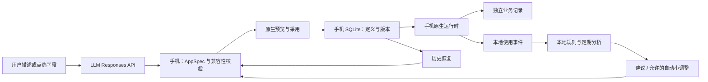

# 生长 Living Apps — Android 架构与开发方案

[English](DEVELOPMENT_PLAN.md) | **简体中文**

更新日期：2026-10-29。当前开发版本 0.3.1，原生编辑工作区和已有应用重构均支持本机中英文语言设置；真机验收仍单独列出。

## 产品范围

一个母 App，多个个人子应用。通过自然语言创建和编辑；在手机原生界面中运行；根据实际使用记录产生改进建议。首版覆盖记录、清单、打卡、表单、统计类应用，不执行 LLM 返回的任意代码。复杂游戏、第三方账号连接、跨设备同步不属于首版运行时。

首版闭环：应用库 → 创建/模板 → 离线运行与记录 → 设备内观察 → 提出修改 → 兼容性校验与预览 → 应用版本 → 观察效果/恢复。

## 计算部署决策

| 工作 | 执行位置 | 原因与数据边界 |
|---|---|---|
| 子应用布局与表单渲染 | 手机 | 原生组件解释已校验的 JSON 描述；无远程网页依赖 |
| 界面语言偏好、词典读取与配置刷新 | 手机 | 系统 / 本地语言设置与随包文案；不翻译已有描述或记录，不调用 API 或服务器 |
| 记录增删改查、统计、搜索 | 手机 SQLite | 不上传个人记录 |
| 使用事件、耗时、错误计数、聚合 | 手机 | 仅记录事件名、版本、时长；不记录输入正文 |
| 常用入口识别、低风险改进规则 | 手机 | 确定性规则即可完成，无 LLM 成本 |
| 版本、候选修改、兼容校验、恢复 | 手机 | 原子事务更新应用描述，业务记录独立保存 |
| 编辑面板、语义点选、撤销重做、草稿与合并 | 手机 / SQLite | 输入与对话本机持久化；API 只接收必要上下文；并发写入与迟到结果独立检查 |
| 试用表单、固定动作、临时记录与试用统计 | 手机 | 同一渲染器，试用写入独立草稿副本；按钮只在用户点击后执行 |
| 类型 / 数值 / 选项转换及转换前备份 | 手机后台线程 / SQLite | 固定转换器演算，数据指纹复查、SHA-256 校验与事务提交；无需服务端 |
| 延迟后台分析 | 手机 JobScheduler | 由 Android 调度，不承诺精确时刻或应用强行停止后运行 |
| 自然语言生成与修改 | 远端 LLM API | 手机直接调用 Responses API；发送描述及当前应用定义 |
| 可选 LLM 深度优化 | 远端 LLM API | 用户发起；仅发送应用定义与聚合行为摘要，不发原始记录 |
| 模型发现、错误处理、JSON 验证 | 手机 | 本地完成，失败保留当前可用版本 |
| 自建业务后台 | 首版不需要 | 未来只有账号同步、协作、集中计费等明确需求再引入 |

应用运行和个人数据保存在设备上；LLM 按要求全部走 API，不在设备上运行大模型。API 网关自身的运行方式不属于本项目控制范围。

## 架构

- Android 8.0+；原生 Java + Android Views。使用现有 SDK、SQLite、JobScheduler、Keystore，首版不引入 JS 引擎/云构建服务。
- AppSpec v1 / v2：稳定字段 ID、类型、标题、选项、默认值、统计字段、有限布局；v2 增加分组、隐藏和受约束固定动作。
- Store：应用/版本/记录/事件/优化候选/草稿/转换备份，SQLite v1/v2 升级到 v3 保留旧数据；事务与草稿 CAS 防止覆盖。数据转换使用 data_epoch，禁止跨转换直接恢复旧定义。
- EditorActivity + EditSession + EditChanges：原生编辑、范围校验、持续对话、孤立试用、三方合并与版本提交。
- SpecValidator + Compatibility：拒绝任意代码、未知组件、删除旧字段、改变字段类型等不兼容修改。
- ReflectionEngine：本地规则依据真实事件产出候选；只在用户开启时自动应用允许列表中的小调整，保留历史版本。
- ResponsesClient：可配置 base URL、模型发现；`store:false`；不自动跟随携带认证的重定向；错误脱敏。
- SecretVault：API Key 经 Android Keystore AES-GCM 加密后保存在应用私有区；不写进 APK、源码或导出备份。

## 实施检查点

- [x] 检查工作区和本机 Android 工具链
- [x] 调研动态 UI、表单、反思机制的开源参考
- [x] 实现应用定义、兼容校验和有意义的 JVM 测试
- [x] 实现 SQLite 存储和独立版本历史
- [x] 实现母应用界面、模板、运行时与记录/统计
- [x] 实现本地使用观察、建议、自动小调整和恢复
- [x] 接入 Responses API，验证目标模型与真实生成和第二轮修改
- [x] 编译 APK、检查 lint；核心、编辑器、存储和数据转换测试已执行，数量见验证报告
- [x] 原生编辑 / 持续草稿 / 隔离试用 / 合并 / 固定动作 / 受限数据转换
- [x] 补齐操作文档、开源评估记录和验证报告
- [ ] 连接真机执行设备测试，验证后台省电策略、Keystore、系统文件选择器和不同屏幕

## 已实现的数据流

采用新定义时对版本基线做检查，陈旧修改和陈旧表单不能覆盖新版本。恢复只生成定义的新版本，业务记录保留；较新字段在旧界面中隐藏，其值不被旧版表单覆盖。后台规则不调用 API，人工深度分析只发送定义和汇总。

## 持续开源检索机制

每进入一个模块，先检索成熟项目，记录到 OPEN_SOURCE_REVIEW.md：项目、版本/访问时间、许可证、可直接复用部分、参考部分、放弃原因和未来替换点。优先直接采用 Android 平台能力；不为“复用”引入不需要的服务器和巨大运行时。复用代码时带入原许可与归属；仅参考设计时明确不声称使用其实现。

## 首版验收

1. 断网仍可运行多个子应用、保存记录、查看统计、恢复应用旧版本。离线架构与框架测试已覆盖；物理设备飞行模式验收待执行。
2. API 配置后，用真实自然语言生成应用，并可通过第二轮指令修改。
3. 无效/不兼容输出不会覆盖可用应用；切换版本不会删除业务数据。
4. 优化建议来自实际事件；没有足够数据时明确不足，不伪造效果。
5. 允许的自动优化可撤销；冻结后不再自动修改。
6. APK/源码/备份/日志不包含开发者提供的密钥。

详细证据与未覆盖项见 [VALIDATION.md](VALIDATION.zh-CN.md)。Android 的周期任务会受约束和系统调度影响，不能将“6 小时间隔”当成准确执行时刻，参见 [JobInfo.Builder 官方说明](https://developer.android.com/reference/android/app/job/JobInfo.Builder#setPeriodic(long))。

## 已知界限

应用不预设私人 API 网关，首次使用 AI 功能需填写自己的可信 HTTPS 地址和凭据。HTTP 仅允许本机与安卓模拟器开发地址。普通使用、记录、编辑与规则无需连接模型。

## 已安装应用重构（2026-10-29）

第二种标准模式由 RebuildActivity、RebuildSpec/RebuildLayout、RebuildStore 和 RebuildAccessibilityService 实现，描述及操作边界独立于 AppSpec 和业务记录。前文不接入第三方账号服务指直接服务集成；本模式通过用户授予的 Android 能力操作已安装客户端。

| 新增计算 | 部署位置 | 边界 |
|---|---|---|
| 启动应用发现、来源签名与版本检查 | 手机 PackageManager | 不申请全部应用列表权限，不远程上传清单 |
| 语义树、列表、页面匹配和覆盖界面 | 手机无障碍服务 | 仅当前授权来源；无截图/上传；遍历有上限 |
| 固定点击/输入/滚动流程 | 手机主线程 | 用户触发；唯一定位、页面基线及有限等待；停止取消剩余步骤 |
| 描述、历史、试用状态及版本检查 | 手机私有 SQLite | 独立于记录和原应用数据库；编辑/恢复清除试用确认 |
| 可选外观生成 | 现有可配置 Responses API | 仅用户需求及匿名编号/类型；无定位、原页面内容或新增操作；预览后采用 |
| 新增业务服务器 | 无 | 本模式不需要 |

详见[设置与限制](REBUILD_MODE.zh-CN.md)。运行层已实现，真实跨应用和 OEM 兼容仍需真机验收，不能由宿主测试推断。
