# 生长 0.2.0 · 原生编辑工作区

[English](UI_DESIGN.md) | **简体中文**

沿用 0.1.1 的应用库和视觉系统，0.2.0 增加应用画面内的编辑工作区。顶部提供试用和完成，第二行是撤销、重做、记录项和更多；底部面板独立滚动，画面仍可点选。

## 编辑器

面板收起只保留对象名，半屏提供快捷调整、AI 修改和对话，展开容纳长需求。选中对象使用轮廓、名称和无障碍说明共同提示。三种模式分别写正式库、草稿和试用副本；显示清楚当前状态。

| 点选与离线修改 | 隔离试用 | 320 dp / 1.3 倍字号 |
|---|---|---|
| 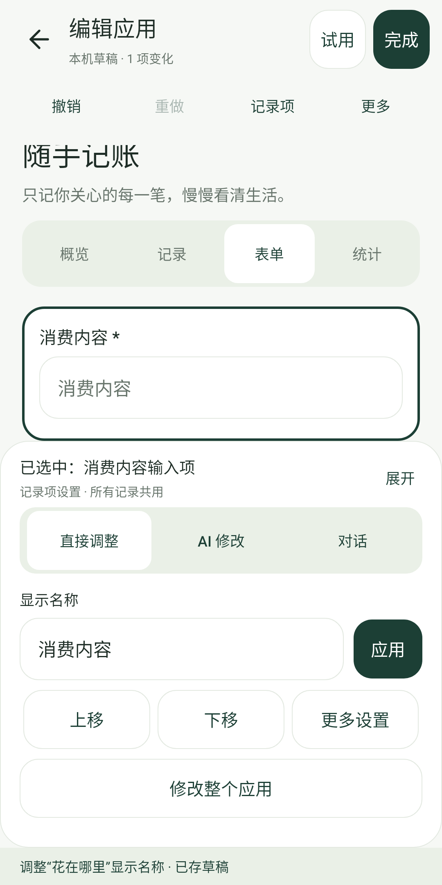 | 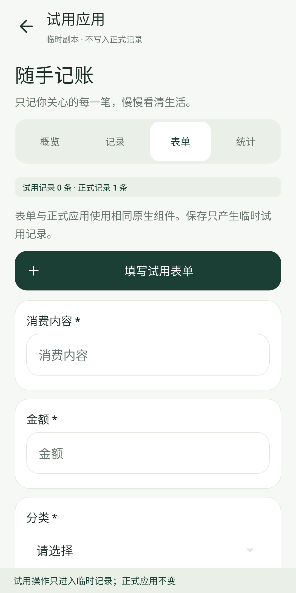 | 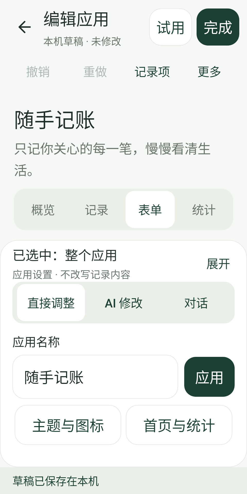 |

这些是实际 View 的宿主 Android 原生渲染。窄屏检查了顶部按钮可见与可滚动面板；键盘、TalkBack、手势与真实系统边距仍需真机验证。

## 视觉规则

| 项目 | 当前实现 |
|---|---|
| 背景 / 文字 | 浅灰绿 `#F6F8F5`；深色正文 `#1E2D26`；次级文字 `#68756C` |
| 品牌 / 强调 | 森林绿 `#1C3F35`；浅青柠 `#DBEEAB`；子应用保留自身强调色 |
| 字体 | Android 系统字体；页面标题 25–29 sp，卡片标题 15–18 sp，正文 13–15 sp，数据 25–42 sp |
| 布局 | 22 dp 页面边距，12 dp 卡片间距，22–25 dp 圆角；主要按钮与工具栏按钮至少 48 dp |
| 图标 | 27 个 Lucide 线性矢量图标；生成应用自定义的图标字符仍可显示 |
| 反馈 | 卡片点击涟漪、明确的分段选中态、空状态说明、先预览再采用 |
| 小屏 / 大字号 | 宽度小于 360 dp 或字号比例大于 1.2 时，应用卡片单列；创建横幅缩小插画并采用更短文案 |

## 已实现的页面

- 应用库：品牌栏、紧凑的创建卡片、双列应用卡片、离线模板列表。
- 子应用：工具栏里的编辑/版本/更多、分段导航、突出累计值的概览、简洁记录卡片。
- 统计：主要数据卡片、两项辅助计数、集中展示的分类条形分布。
- 创建：三步提示、自然语言输入区、可点击填入的灵感、固定生成按钮。
- 预览：应用身份、变更说明、真实表单试填、固定采用/返回动作。
- 生长：品牌插画、等待观察的空状态、真实使用计数、可预览的改进建议。
- 设置：分组的 AI 配置、优化开关、备份与许可；使用一致的原生控件样式。

## 实际界面渲染

下图由 Robolectric 的 Android 原生 View / 图形运行时生成，含合成测试数据。它们来自实际实现，不是概念效果图，也不是真机截图。

| 应用库 | 创建应用 | 生长观察 |
|---|---|---|
|  | 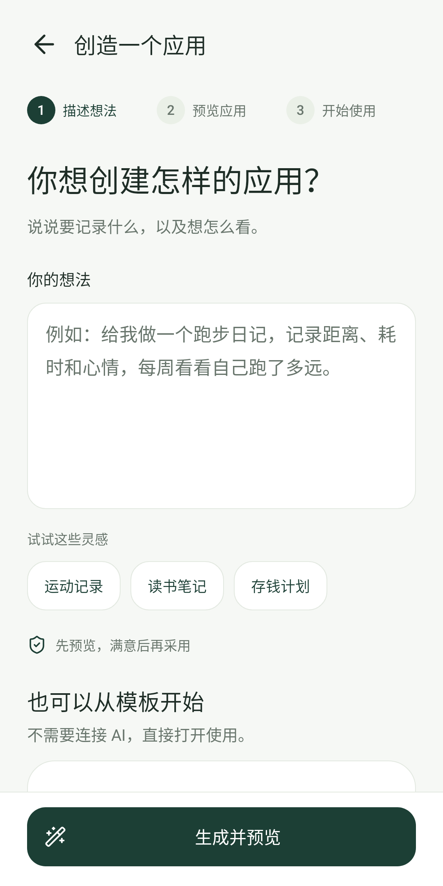 | 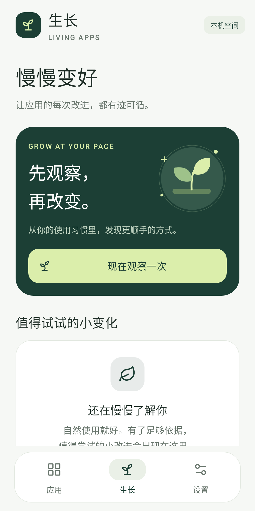 |

| 子应用概览 | 统计 | 版本预览 |
|---|---|---|
| 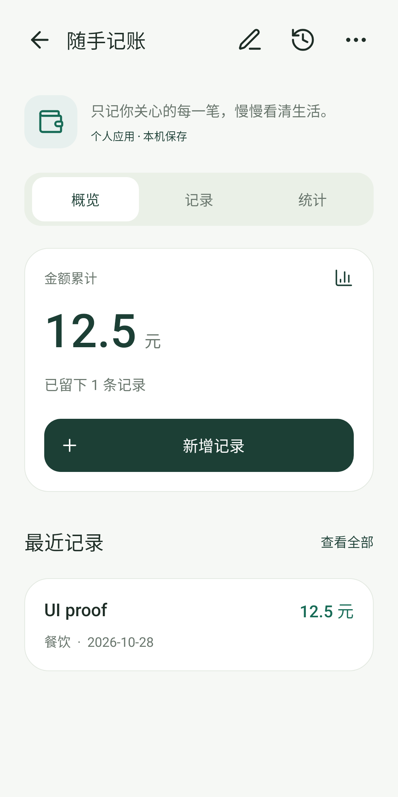 | 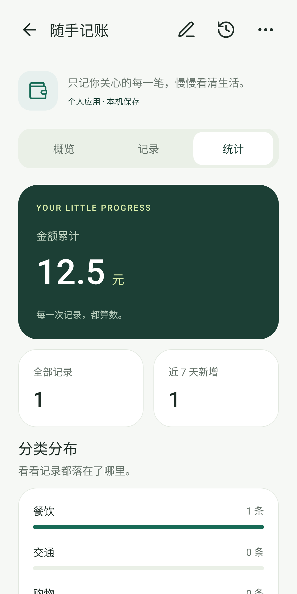 | 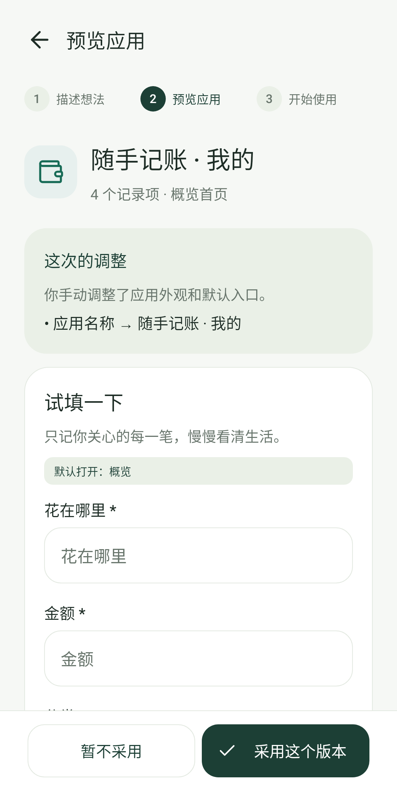 |

| 设置 | 320 dp / 1.3 倍字号首页 | 320 dp / 1.3 倍字号创建页 |
|---|---|---|
| 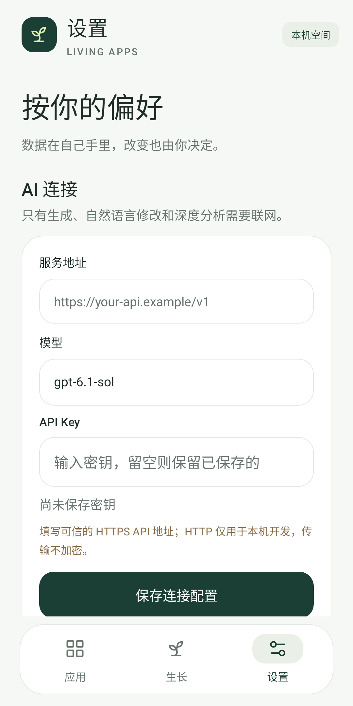 | 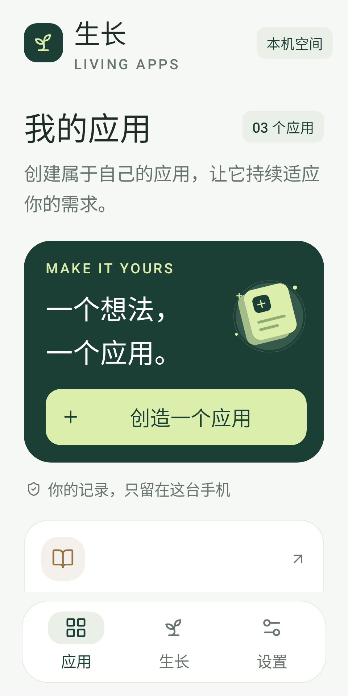 | 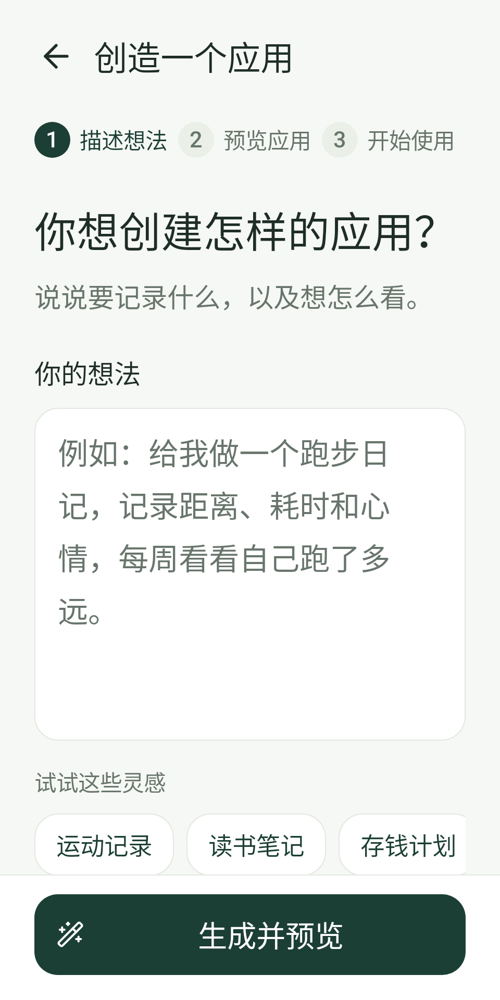 |

回归流程覆盖：从应用库打开工具、填写并保存记录、查看统计、进入生长/设置、创建页面、离线修改名称、试填预览并采用版本；调整后记录仍保留。软键盘与真实系统导航栏、OEM 字体及其他设备仍需要真机验收。
